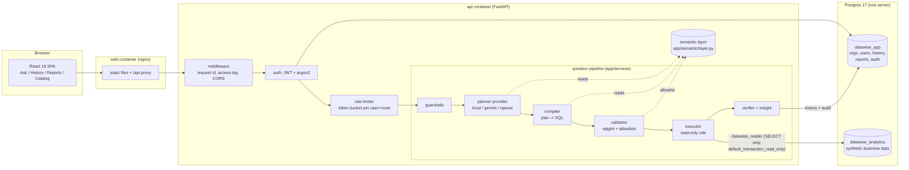
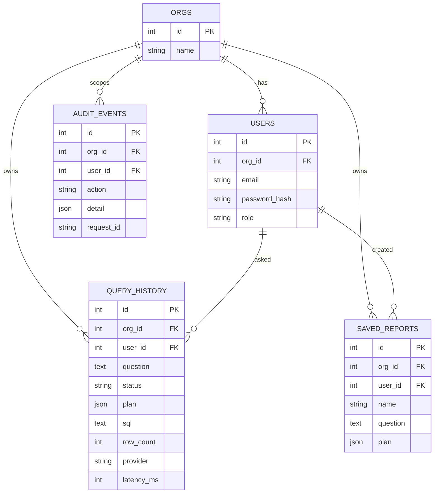
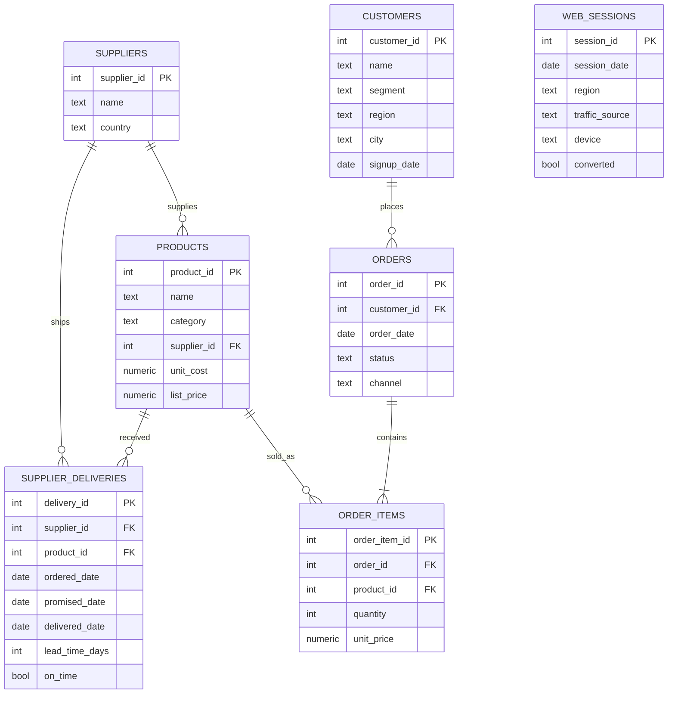

# Architecture

DATAWISE AI answers business questions in plain language without ever executing SQL written by a
model. The planner (rule-based by default, optionally Gemini/OpenAI) may only emit a typed
`QueryPlan`; our own compiler turns that plan into SQL from a semantic layer, a validator re-parses
and checks it, and an executor runs it as a read-only database role.

## Component view



Key boundaries:

| Boundary | Enforcement |
|---|---|
| Model output -> SQL | Planner returns `PlannerOutcome` (Pydantic, `extra="forbid"`). There is no field that can carry SQL. |
| Plan -> SQL | `app/services/compiler.py` uses only registry identifiers; values become escaped literals via sqlglot. |
| SQL -> database | `app/services/validator.py`: one statement, SELECT only, no DML/DDL nodes anywhere in the tree, allowlisted tables/columns/functions, outer `LIMIT <= MAX_ROWS`. |
| Database privileges | `datawise_reader`: CONNECT on analytics only, `SELECT` only, `default_transaction_read_only=on`; executor also sets `SET TRANSACTION READ ONLY` and `SET LOCAL statement_timeout`. |
| Tenant data | Every app-DB row has `org_id`; history/report queries filter by the caller's org. |

## Backend layout

```
backend/app/
  main.py              app factory, middleware, routers
  core/                config, db, security (JWT/argon2), logging (structlog), errors, ratelimit
  models/              SQLAlchemy models (app DB)
  schemas/plan.py      QueryPlan, Filter, TimeRange, PlannerOutcome
  schemas/api.py       request/response models (ask contract)
  semantic/layer.py    metrics, dimensions, facts/join paths, allowlist
  services/            guardrails, timeparse, values, compiler, validator, executor, insight, ask, catalog
  llm/                 base.py, local.py, gemini.py, openai_provider.py, structured.py, factory.py
  api/                 auth, questions (+history), reports, catalog, health
backend/scripts/       seed.py (demo users), seed_analytics.py (synthetic data)
backend/alembic/       app-DB migrations
```

## Request sequence: POST /api/v1/questions/ask

```mermaid
sequenceDiagram
  autonumber
  participant U as Browser
  participant A as FastAPI
  participant G as Guardrails
  participant P as Planner
  participant C as Compiler
  participant V as Validator
  participant X as Executor
  participant R as Analytics DB (reader)
  participant D as App DB
  U->>A: POST /questions/ask {question} + Bearer JWT
  A->>A: verify JWT, rate limit, request id
  A->>G: check_question()
  alt unsafe intent
    G-->>A: (category, reason)
    A->>D: history(status=rejected) + audit
    A-->>U: status=rejected
  end
  A->>P: plan(question)
  alt ambiguous
    P-->>A: clarify(question, options)
    A->>D: history + audit
    A-->>U: status=needs_clarification
  end
  P-->>A: QueryPlan
  A->>C: compile_plan(plan)
  C-->>A: SQL (from semantic layer)
  A->>V: validate_sql(sql)
  alt issues
    V-->>A: ok=false, issues
    A->>D: history + audit
    A-->>U: status=rejected + validation.issues (SQL not executed)
  end
  A->>X: execute_readonly(sql)
  X->>R: SET TRANSACTION READ ONLY; SET LOCAL statement_timeout; SELECT
  R-->>X: rows (fetchmany(MAX_ROWS+1))
  X-->>A: columns, rows
  A->>A: verify columns/types, insight from rows, chart type
  A->>D: history(status=answered) + audit
  A-->>U: status=answered, sql, rows, insight, provenance
```

## Data model





Synthetic data window: 2024-11-01 to 2026-10-31 (fixed seed). Relative time phrases are anchored to
`ANALYTICS_AS_OF_DATE` (default 2026-10-31), so "last month" means September 2026.

## Semantic layer

`app/semantic/layer.py` defines three facts (join paths):

| Fact | FROM | Time column | Always-on filter |
|---|---|---|---|
| sales | `orders o JOIN order_items oi` (+ customers c, products p, suppliers s via p) | `o.order_date` | `o.status <> 'cancelled'` |
| web | `web_sessions ws` | `ws.session_date` | -- |
| deliveries | `supplier_deliveries sd` (+ suppliers s, products p) | `sd.delivered_date` | -- |

Metrics: revenue, order_count, avg_order_value, units_sold, active_customers (sales);
conversion_rate, sessions (web); on_time_delivery_rate, avg_lead_time_days (deliveries).
Dimensions: month, quarter, year, product, category, customer, customer_segment, region, supplier,
channel, traffic_source, device -- each bound per fact, so "conversion rate by product" is detected
as impossible and turned into a clarification instead of a wrong join.

## Local planner (deterministic)

1. Parse time phrases (`services/timeparse.py`) and blank them out.
2. Longest-match phrase scan over metric synonyms, dimension synonyms and known values (values are
   loaded once from the analytics DB through the reader role).
3. A dimension noun becomes a GROUP BY only with a grouping cue ("by", "per", "top 5", "which",
   "customers who ..."); "Enterprise customers" alone is a filter, not a grouping.
4. Values that exist in several dimensions ("mobile" = order channel and web device; "Tablet" =
   product and device) are resolved by the fact of the requested metric.
5. Ambiguity -> `needs_clarification` with options that are complete, re-askable questions.

## Insight and provenance

`services/insight.py` computes all numbers from the returned rows in Python (first/last change,
peak, min, total for additive metrics, share of total) and returns provenance entries naming the
columns and row indexes used. Non-additive metrics (rates, averages, distinct counts across
products) are never summed. An empty result produces "No data matched", never an invented value.
