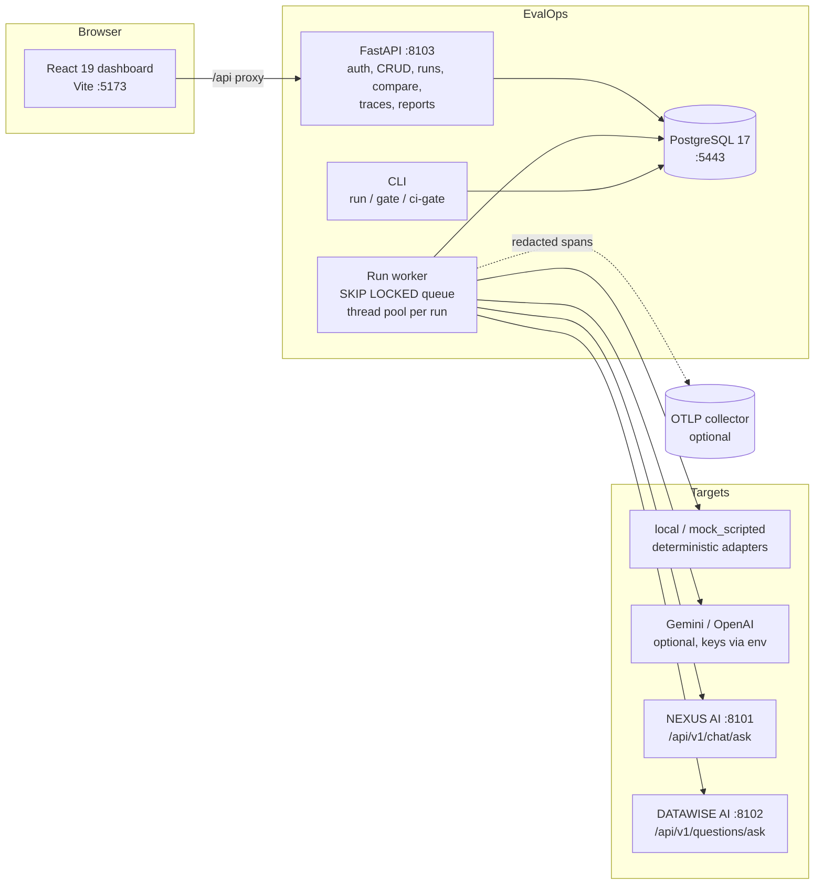
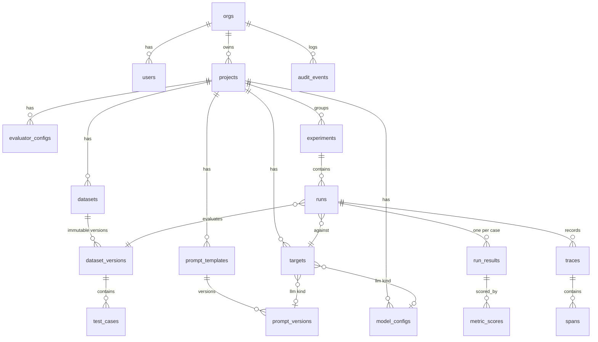
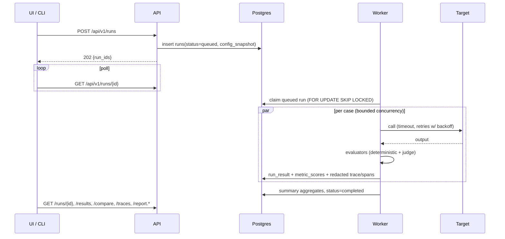

# Architecture

## Components

- **API** (`backend/app/api`) is thin: validate -> call a service -> serialize. Every query is
  filtered by the caller's `org_id` (multi-tenancy).
- **Run engine** (`backend/app/engine`): `create_runs` freezes a config snapshot (target, model
  config, prompt version text + hash, evaluator configs, dataset version + content hash, seed,
  concurrency/timeout/retries, git sha) and inserts `runs` rows with status `queued`. A worker claims
  one with `UPDATE ... WHERE id = (SELECT ... FOR UPDATE SKIP LOCKED LIMIT 1)` and executes all cases
  in a bounded thread pool. Per case: call the target (retries with exponential backoff + seeded
  jitter on transient errors), record spans, run evaluators, persist result + scores + trace.
  At the end the run summary (aggregates) is computed and stored on the run.
- **Worker placement**: embedded in the API process in dev (`RUN_WORKER_IN_API=true`), a separate
  `worker` container in docker compose. Multiple workers are safe thanks to SKIP LOCKED.
- **Evaluators** (`backend/app/evaluators`): pure functions registered by type. `kind=deterministic`
  or `kind=judge`. Judge scores are always `is_estimate=true` and never gate case pass/fail.
- **Tracing** (`backend/app/services/tracing.py`): in-memory span recorder per case, redacted by
  `core/redaction.py` before it is written to `traces`/`spans`, optionally exported over OTLP.

## Data model (ER)

Every tenant-owned table has `org_id`. `dataset_versions.content_hash` is a SHA-256 over the
canonical JSON of the cases; re-uploading identical content returns the existing version.

## Run sequence

## Deviations from MASTER_ARCHITECTURE.md

- The MASTER doc lists `llm/` provider names `local|gemini|openai`. EvalOps adds a fourth
  deterministic provider, `mock_scripted`, which replays outputs scripted in the dataset to make
  regression demos reproducible. It is labeled as a fixture everywhere.
- NEXUS returns database UUIDs as `document_id`, which change on every NEXUS reseed. The
  `http_nexus` target therefore matches citations on `document_title` by default
  (`target.config.citation_key`).
- Optional DeepEval/RAGAS integrations are installed manually (not uv extras) because they conflict
  with `openai==3.51` in one lock file.
