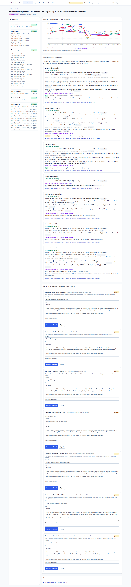

# NEXUS AI -- Autonomous Enterprise Intelligence Platform

NEXUS answers questions over company documents with page-level citations, and runs multi-agent
investigations across CRM, ERP, email and document data. Every outbound action waits for a human
approval before anything is sent.

> Demo mode runs entirely offline with a **deterministic local adapter** (rule-based, clearly
> labeled in the UI and API). Set `LLM_PROVIDER=gemini` or `openai` with a key to use a real model.



## The flagship demo
A manager asks: *"Investigate why purchases are declining among our top ten customers."*

1. A **supervisor agent** (LangGraph) validates the goal and plans the agents to run.
2. The **data agent** ranks the top 10 customers from ERP orders and finds 7 with a decline of 10% or more.
3. The **research agent** gathers each customer's emails, pending quotations and document
   excerpts (hybrid search).
4. The **analysis agent** separates **evidence** (quoted from records, with source ids) from
   **hypotheses** (inferences with confidence). Sources the agents did not actually gather are
   dropped.
5. The **report agent** writes the report; the **action agent** drafts follow-up emails as
   **approval requests**.
6. A manager edits and approves a draft, and it is delivered exactly once to the local outbox
   connector.

The synthetic seed plants a different real cause for each declining account (competitor pricing,
late deliveries, a rejected batch, a budget freeze, an expired contract, and one account with no
signal). The integration tests assert the system recovers each cause.

## Features
| Area | What is implemented |
|---|---|
| Multi-tenancy and RBAC | Orgs, users, roles (viewer/analyst/manager/admin), org-scoped queries everywhere, JWT + argon2 |
| Ingestion | PDF (page numbers), DOCX (sections), XLSX (sheets), CSV, TXT, MD, allowlisted web pages; Postgres SKIP LOCKED job queue + worker; retries |
| Upload security | Size limits with bounded reads, magic-byte checks, zip-bomb and macro rejection, SSRF-safe URL fetch |
| Retrieval | pgvector HNSW + Postgres full-text, Reciprocal Rank Fusion, reranking, page-level citations |
| Q&A | Grounded answers, citation validation, abstention, conversation history, explicit long-term memory |
| Agents | LangGraph supervisor + 5 specialised agents, checkpointed steps, timeouts, retries, resume, token budgets |
| Tools | Typed registry (Pydantic in/out), role checks, side-effect classes, audit; MCP server exposes read tools |
| Safety | Prompt-injection scanner + untrusted envelopes, source grounding, human approval, idempotent sends |
| Observability | Request ids, JSON logs with redaction, audit trail, token/cost/latency usage records |
| UI | Ask, Investigations (agent activity, chart, findings, approvals), Approvals queue, Documents, Admin |

## Quickstart
```bash
cd nexus-ai
cp .env.example .env              # set DEMO_USER_PASSWORD
docker compose up -d db
cd backend && uv sync && uv run alembic upgrade head && uv run python -m scripts.seed
uv run uvicorn app.main:app --port 8101
# new terminal
cd nexus-ai/frontend && npm ci && npm run dev    # http://localhost:5171
```
Sign in as `manager@acme.example` with your `DEMO_USER_PASSWORD`.
Full Docker stack: `docker compose --profile full up --build` (web on http://localhost:8081).

## Documentation
- [Architecture, ER and sequence diagrams](docs/architecture.md)
- [API reference and examples](docs/api.md)
- [Environment variables](docs/env.md)
- [Local setup and troubleshooting](docs/setup-and-troubleshooting.md)
- [Docker and deployment](docs/deployment.md)
- [Security and threat model](docs/security-threat-model.md)
- [Testing strategy and results](docs/testing.md)
- [Performance and evaluation methodology](docs/evaluation-methodology.md)
- [Architecture decision records](docs/adr/)
- [Roadmap and limitations](docs/roadmap-and-limitations.md)
- [Interview handbook](interview-preparation/README.md)

## Tech
Python 3.12, FastAPI, Pydantic v2, SQLAlchemy 2.1, Alembic, PostgreSQL 17 + pgvector, LangGraph
1.2, MCP Python SDK 2.x, google-genai / openai SDKs, React 19, TypeScript 5.9, Vite 7, Tailwind 4,
Recharts, pytest, Vitest, Playwright, Docker, GitHub Actions.

## Status
Verified locally: 97 backend tests, 4 frontend tests and 4 Playwright e2e tests pass; ruff and
mypy are clean. **Not deployed** (no cloud credentials). See [roadmap](docs/roadmap-and-limitations.md)
for the honest list of limitations.
