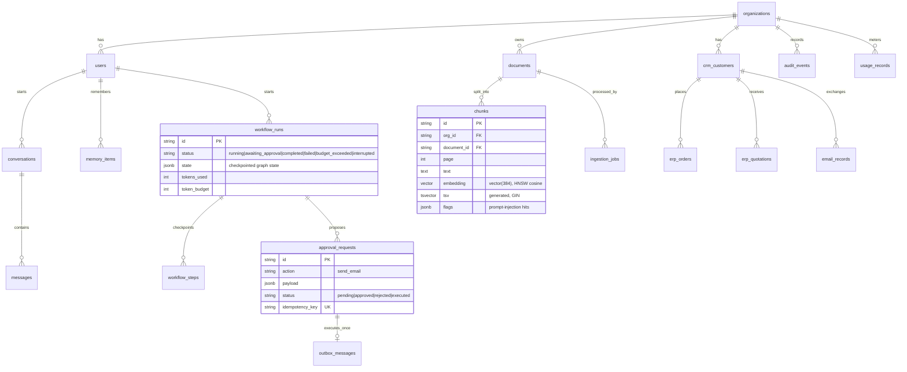
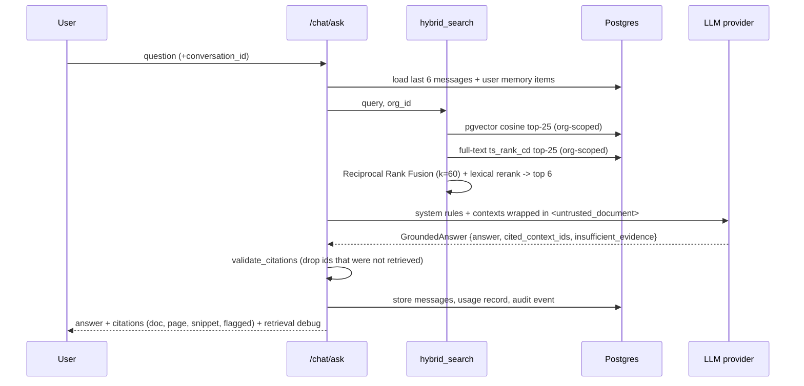
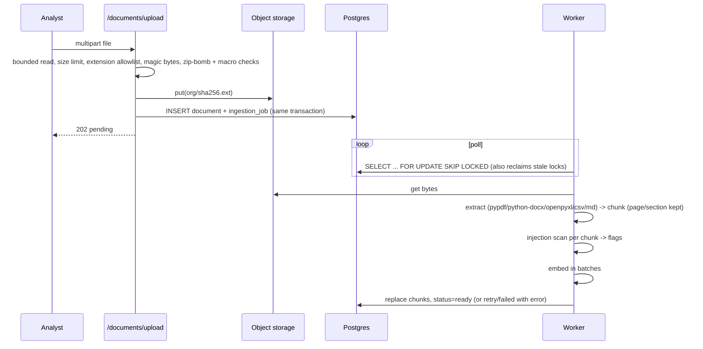
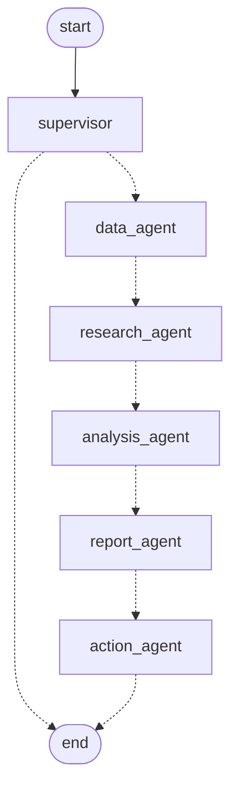

# NEXUS AI -- Architecture

## 1. System overview

```mermaid
flowchart LR
  subgraph Browser
    UI[React SPA<br/>Ask / Investigations / Approvals / Documents / Admin]
  end
  subgraph API["FastAPI (app.main)"]
    MW[Middleware: request id, security headers, CORS, JSON errors]
    AUTH[JWT auth + role checks + rate limit]
    CHAT[services.chat]
    WF[services.workflows]
    APPR[services.approvals]
    DOCS[api.documents]
  end
  subgraph Agents["LangGraph investigation graph"]
    SUP[supervisor] --> DA[data_agent] --> RA[research_agent] --> AA[analysis_agent] --> REP[report_agent] --> ACT[action_agent]
  end
  subgraph Tools["Typed tool registry (tools.registry)"]
    T1[search_customers / get_top_customers / get_customer_orders]
    T2[search_documents / search_emails / get_pending_quotations]
    T3[generate_report / draft_followup_email]
    T4[send_email -- approval required, never MCP-exposed]
  end
  subgraph Ingestion
    Q[(ingestion_jobs<br/>SKIP LOCKED queue)] --> W[worker: extract -> chunk -> scan -> embed]
  end
  LLM[[LLM provider<br/>local | gemini | openai]]
  EMB[[Embedder<br/>local hashing | gemini | openai]]
  PG[(PostgreSQL 17 + pgvector<br/>HNSW + GIN tsvector)]
  OBJ[(Object storage<br/>local dir / S3-compatible)]
  MCP[MCP server<br/>python -m app.mcp_server]

  UI -->|/api/v1| MW --> AUTH
  AUTH --> CHAT & WF & APPR & DOCS
  CHAT --> PG & LLM
  WF --> Agents
  Agents --> Tools
  Agents --> LLM
  APPR --> T4
  Tools --> PG
  DOCS --> OBJ & Q
  W --> OBJ & EMB & PG
  MCP --> Tools
```

Layering (backend/app):

| Layer | Package | Rule |
|---|---|---|
| HTTP | `api/` | Validate input, call a service, serialize. No SQL beyond trivial lookups. |
| Services | `services/` | Business logic, transactions, audit. No FastAPI imports. |
| Agents | `agents/` | LangGraph graph + checkpointed step runtime. Talk to data only through tools. |
| Tools | `tools/` | Typed, permissioned, audited capabilities. Shared by agents and MCP. |
| Connectors | `connectors/` | Data-source adapters (local demo CRM/ERP/email). |
| Ingestion | `ingestion/` | Validation, extraction, chunking, injection scan, SSRF-safe fetch, queue. |
| LLM | `llm/` | Provider abstraction, deterministic local adapter, embeddings, pricing. |

## 2. Data model (ER)



Every tenant-owned table carries `org_id`; every query filters by the caller's org (tested in
`tests/test_api_integration.py::test_tenant_isolation_documents_and_retrieval`).

## 3. Key workflows

### 3.1 Grounded question answering



### 3.2 Ingestion



### 3.3 Investigation with human approval

```mermaid
sequenceDiagram
  participant M as Manager
  participant API as /workflows
  participant G as LangGraph
  participant RT as run_step (checkpoint, timeout, retry, budget)
  participant T as Tool registry
  participant A as /approvals
  M->>API: goal
  API-->>M: 202 run_id (graph runs as background task)
  API->>G: invoke(state)
  G->>RT: supervisor -> WorkflowPlan (allowed agents only)
  G->>RT: data_agent -> get_top_customers, get_customer_orders
  G->>RT: research_agent -> search_emails, get_pending_quotations, search_documents (customer excerpts)
  G->>RT: analysis_agent -> EvidenceAnalysis, then ground_sources() drops ungathered sources
  G->>RT: report_agent -> generate_report
  G->>RT: action_agent -> draft_email + draft_followup_email (creates pending approvals only)
  RT->>T: every call: role check, input/output validation, audit
  Note over API: run.status = awaiting_approval
  M->>A: approve (optionally edit subject/body)
  A->>A: SELECT ... FOR UPDATE on approval row
  A->>T: send_email(idempotency_key) -> outbox (exactly once)
  A-->>M: executed; run completes when no approvals are pending
```

## 4. Reliability model for agent workflows

- **Checkpoints**: each node writes `workflow_steps.output` and merges it into
  `workflow_runs.state` in the same transaction. `resume` resets non-completed steps and re-invokes
  the graph; completed steps return their stored output without re-running.
- **Timeouts**: each attempt runs in a worker thread with its own DB session; if it exceeds
  `WORKFLOW_STEP_TIMEOUT_S` the attempt is abandoned and its session is rolled back, so a late
  finisher cannot commit.
- **Retries**: transient exceptions retry with exponential backoff up to
  `WORKFLOW_STEP_MAX_ATTEMPTS`; validation/permission/budget errors fail fast.
- **Budgets**: before every model call the projected token total is checked against the run budget.
- **Crash recovery**: on startup, runs left in `running` are marked `interrupted` and can be resumed.

## 5. Agent graph (generated by LangGraph `draw_mermaid`, simplified)


Dotted edges are conditional: routing follows the supervisor's validated plan, so an
`unsupported` goal ends immediately.
