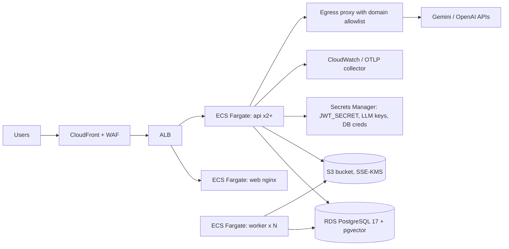

# NEXUS AI -- Docker and deployment guide

**Status: not deployed.** No cloud credentials were available; nothing here has been run on AWS.
The Docker images and compose stack were built and run locally (all services healthy, e2e suite
passed against the containerized stack on 2026-11-16).

## Images
- `backend/Dockerfile`: python:3.12-slim, dependencies installed with `uv sync --frozen --no-dev`
  from `uv.lock`, non-root `app` user, healthcheck on `/healthz`. The same image runs the API
  (`uvicorn`) and the worker (`python -m app.worker`).
- `frontend/Dockerfile`: Node 24 build -> nginx 1.29 serving static files with security headers
  and a CSP; `/api/` is proxied to the API service.

## Recommended AWS-compatible production topology

| Concern | Recommendation |
|---|---|
| Database | RDS PostgreSQL 17 with pgvector extension enabled; run `alembic upgrade head` as a one-off ECS task before deploying new API tasks |
| Object storage | `S3Storage` exists (`STORAGE_BACKEND=s3`, bucket/region via env, IAM task role via the default boto3 chain, SSE AES256 on AWS). Verified with moto and a real S3-compatible server (compose profile `s3`); not verified against real AWS S3 |
| Tracing | Set `OTEL_EXPORTER_OTLP_ENDPOINT` to an OTLP/HTTP collector (e.g. ADOT collector sidecar); spans carry ids/sizes/tokens only, never prompt text |
| Secrets | Secrets Manager -> ECS task env; never bake into images |
| Workers | Separate ECS service running `python -m app.worker`; set `INGESTION_MODE=worker` on API tasks |
| Rate limiting | Current limiter is per process; put WAF rate rules in front or move to Redis |
| Egress | Route outbound HTTP (URL ingestion, LLM APIs) through an allowlisting proxy (closes the DNS-rebinding gap noted in ssrf.py) |
| Observability | JSON logs to CloudWatch; request ids propagate via `X-Request-ID` |
| TLS | Terminate at ALB/CloudFront |

## Deployment steps (when credentials exist)
1. Build and push `backend` and `frontend` images to ECR (CI `docker` job builds them today).
2. Run migration task: `alembic upgrade head`.
3. Update ECS services (api, worker, web) with the new image tags.
4. Smoke test `/readyz` and a login.
